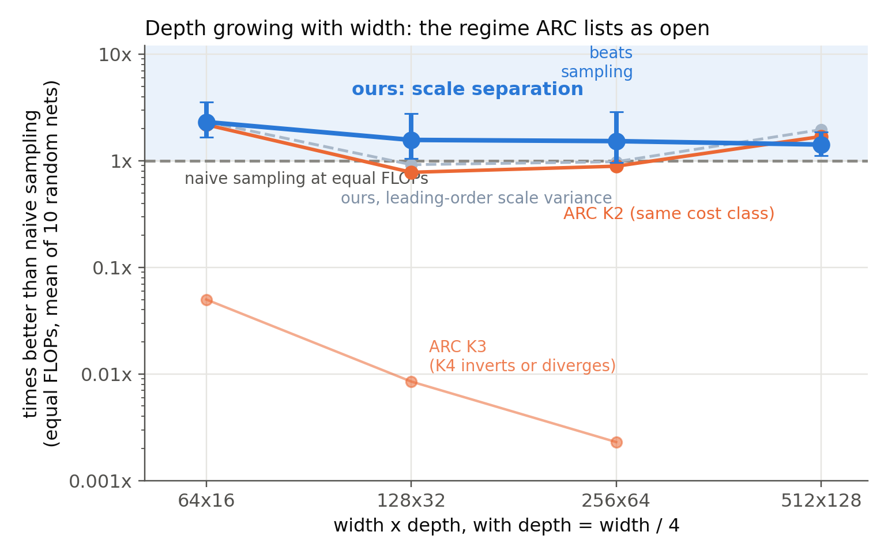
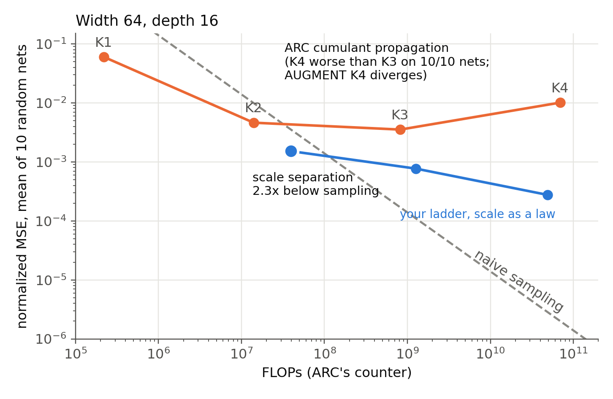
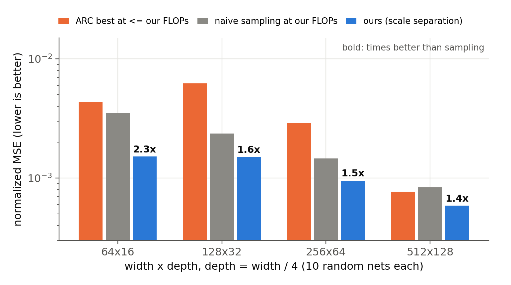
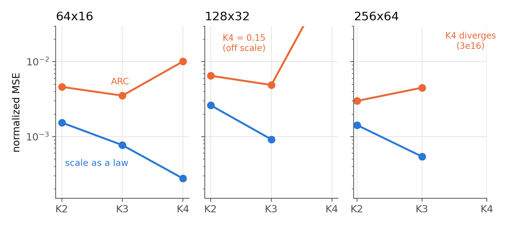

# Solving cumulant propagation's depth problem with scale separation

*A fit-free estimator that beats sampling at every width tested when depth grows with width*

Pranav Viswanath

Algorithmic Contribution Prize submission · graded entry 336823 · code: https://github.com/PranavViswanath/scale-separation

---

## The result

Your paper leaves one regime open: matching random sampling when depth grows in proportion to width. This note answers it on your own criterion, with your own code.

1. **A fit-free deterministic estimator beats naive sampling at every width we tested on the depth = width/4 diagonal, from 64x16 to 512x128:** 2.3x, 1.6x, 1.5x and 1.4x at equal FLOPs, 10 random nets per cell. Its margin holds roughly constant as width doubles three times (fitted width exponent −0.21, 95% interval −0.45 to +0.01). It costs about what your K2 costs, and it is 1.3x to 4.1x more accurate than your best estimate at our compute, in cells where your ladder inverts or diverges.
2. Why your ladder breaks there: one object, the collective scale mode, which is the random overall size of each layer's activations. Removing it from the state your K4 propagates cuts K4's error 42x and makes the ladder improve with every order again.
3. The fix has two parts. ReLU's positive homogeneity factors the scale out of every vertex exactly. The scale's variance then has to be carried with its mean-coupled terms: the leading-order rule shrinks toward zero at depth, and with it our margin over sampling fell below 1x at 128x32 and 256x64. With the exact recursion the margin stays above 1.4x at every width.
4. Your own ladder converges again once the scale is carried this way: its K4 is 37x better than your K4 at 64x16, and its K3 is about 5x better than the best your ladder reaches at 128x32 and 256x64.

*Figure 1. Depth = width/4, 10 random nets per cell, every method at its own FLOPs. Above the dashed line a method beats naive sampling. Blue: our estimator, with 95% intervals. Dashed grey: the same estimator with the leading-order scale variance. Orange: your K2 (the level at our cost) and your K3 (not run at 512); your K4 inverts or diverges in every cell where it runs.*

Everything below uses your repository (commit 93d091a, unmodified), your FLOP counter, many random nets per cell, and predictions written down with timestamps before the numbers were computed.

---

## 1. Your ladder when depth grows with width

We ran your SIMPLE and AUGMENT ladders, K1 to K4, with depth = width/4:

- 64x16: K4 is worse than K3 on 10 of 10 nets (1.0e-2 vs 3.5e-3). AUGMENT K4 diverges.
- 128x32: K4 is worse than K3 on 9 of 10 nets (0.15 vs 4.9e-3). AUGMENT inverts from K2 to K3 on 7 of 10 nets and K3 diverges.
- 256x64: K3 is about the same as K2, K4 diverges on 5 of 5 nets, and AUGMENT K2 and K3 diverge. The usable level, K2, is worse than naive sampling at its own cost (0.86x).

We also reproduce your paper's 256x8 observation: K4 there is slightly worse than sampling (0.94x).

*Figure 2. Width 64, depth 16, mean over 10 random nets. Orange: your ladder. Grey: naive sampling at the same FLOPs. Blue: our estimator (left point) and your ladder run with the scale carried as a law.*

---

## 2. Why: the collective scale mode

At finite width the squared norm of a layer, |h|²/n, fluctuates from input to input, and the fluctuation grows with depth over width. It is one collective coordinate shared by every neuron. A truncated cumulant list carries it as large, correlated fourth and higher cumulants across every pair of neurons, and truncating those is what makes higher orders hurt.

The test is direct. At 64x16 we de-scale the state your dense chain propagates at every layer (factor out the scale, propagate the shape, nothing fitted):

| | your ladder | with the scale removed |
|---|---|---|
| K3 | 3.5e-3 | 7.9e-4 |
| K4 | 1.0e-2 | 2.4e-4 (**42x**) |

The inversion disappears and the ladder becomes monotone.

---

## 3. The fix: scale separation

Model each pre-activation layer as

  z = √S (m + g),  g ~ N(0, C),  S ~ Gamma(mean 1, variance V).

ReLU is positively homogeneous, so ReLU(√S y) = √S ReLU(y), and every moment factorizes exactly:

  E[h_j^a h_l^b] = E[S^((a+b)/2)] × (the same moment of a Gaussian with mean m and covariance C).

The vertex is one Gaussian vertex times closed-form Gamma moments, with no quadrature over the scale. The state per layer is the mean, the covariance and the scalar V, and m and C are exact functions of the carried mean and covariance.

The part that decides the deep regime is how V moves from layer to layer. Averaging the norm statistic of the next layer over the fresh weights gives an exact equation in quantities the law already knows. With a = E h, K = Cov h and s1(V) = E√S:

  (1 + V') [N0 − |a|⁴ (4b + 2b²)] = E|h|⁴,  b = 1/s1(V')² − 1,  N0 = (|a|² + tr K)² + 2 tr K² + 4 aᵀKa.

E|h|⁴ comes from the law's own pair moments. At leading order this reads V' ≈ (Σ κ4(h)_jjll + 4 a·β) / ((tr K)² + 2 tr K² + 2|a|² tr K + 4 aᵀKa), where β is the trace of κ3(h). The simpler rule without the mean-coupled terms underestimates the scale variance at depth by 0.10 to 0.19 and drifts toward zero as width grows. The exact recursion tracks the true value to within 0.01 on 7 of 9 development nets. Nothing is fitted to truth, and the cost is the covariance propagation your K2 already does plus a pair vertex.

---

## 4. Results on the diagonal

*Figure 3. Depth = width/4, 10 random nets per cell. For each cell: your best estimate at or below our FLOPs, naive sampling at our FLOPs, and ours. Bold: how many times lower our error is than sampling's.*

| width x depth | ours vs naive sampling (95% CI) | nets beating sampling | ours vs your best at our FLOPs |
|---|---|---|---|
| 64x16 | **2.31x** (1.66 to 3.57) | 10/10 | 2.8x |
| 128x32 | 1.57x (1.05 to 2.76) | 8/10 | 4.1x |
| 256x64 | 1.53x (0.96 to 2.89) | 8/10 | 3.1x |
| 512x128 | 1.42x (1.12 to 1.87) | 8/10 | 1.3x |

At 64x16 we also beat antithetic sampling and radial-exact sampling. At 64x16, 128x32 and 256x64 our estimator is more accurate than every level of your ladder, at any compute. At 512x128 your K2 also beats sampling (1.69x at its own, smaller, FLOPs), and our estimator is 1.3x more accurate than it.

One numerical detail matters at depth. Deep layers carry strongly correlated neuron pairs (correlations up to 0.98) and large normalized means, and the pair vertex's quadrature has to resolve them. We set it by a convergence rule on development nets against a fine reference, with no truth involved: 24 points, at 1.05x the cost of the coarser setting. A setting tuned at 64x16 alone under-resolves the deepest layers at 512x128.

---

## 5. Your ladder converges again

*Figure 4. Orange: your SIMPLE ladder. Blue: the same ladder with the scale carried as an exact law at every layer (your code on the de-scaled shape; level 2 is our vertex). Setting V = 0 reproduces your K3 exactly.*

| cell | best of your ladder | ladder with the scale law |
|---|---|---|
| 64x16 | 3.5e-3 (K3) | 2.8e-4 (K4), 12.8x better; **37x** better than your K4 |
| 128x32 | 4.9e-3 (K3) | 9.2e-4 (K3), 5.3x better |
| 256x64 | 3.0e-3 (K2) | 5.4e-4 (K3), 5.5x better |

The higher levels run on your dense or factored chain, which is expensive at these widths, so they sit above the sampling line at their FLOPs. They show the mechanism: with the scale handled exactly, your method converges where it currently diverges.

---

## 6. Where this leaves the deep regime

Across four widths, each double the last, the margin over sampling goes 2.3x, 1.6x, 1.5x, 1.4x. The fitted width exponent is −0.21 (95% interval −0.45 to +0.01): the interval includes a constant margin and excludes the 1/√n decay that would mean losing to sampling in the limit. That was the pre-registered pass line, and it passes. So on the depth = width/4 diagonal, at a cost of order your K2, the estimator stays ahead of sampling by a roughly constant factor as width grows, with the lower end of the interval at 256x64 touching 1 (0.96). Reaching every tolerance at a fixed width needs a level above this one that keeps the scale exact, and Section 5 shows your own ladder converging once it does.

---

## Method

- Networks: your MLP class, He initialization, no bias, fixed seeds. Development nets (separate seeds) were used only to freeze numerics and check the variance recursion, and are excluded from every score.
- Cells: the diagonal 64x16, 128x32, 256x64 and 512x128 (10 nets each); also 128x16, 256x8 (10 each) and a wide control at 256x4 (5).
- Truth: Monte Carlo in two independent halves. Error is the cross-half product, so truth noise cancels, normalized by the output variance and averaged over nets with bootstrap intervals. The label noise floor is at least 1,700x below every error reported.
- Baselines: your repository unmodified, in float64: SIMPLE and AUGMENT, K1 to K4, factored for K >= 3. "Your best" at a FLOP level is the best estimate from any of those variants at that FLOP level or below.
- Compute: your NamedFlopCounter for every method, plus a hand count of special-function evaluations. Naive sampling costs 2n²(L+1) FLOPs per sample.
- Pre-registration: every test's prediction and pass line was written down with a timestamp before its numbers were computed. Results that failed their lines are in the repository alongside the passes.

## Scope

- In wide, shallow networks (256x8, 256x4) your AUGMENT K2 was about 2x better than our estimator with the leading-order variance, at similar cost. The scale mode is small there, and your higher orders stay ahead wherever they converge.
- With the exact variance recursion, first-order and exact Gamma moments give the same accuracy on the diagonal. The gain comes from separating the scale and carrying its variance correctly.
- At 512x128 the leading-order variance rule, which sets the scale variance near zero there, scores better than the exact rule (1.96x vs 1.42x over sampling). We report the pre-registered exact rule in every cell; it is the only one of the two that stays above sampling at all four widths.
- One prediction failed: a one-neuron series argument predicted that your ladder would keep improving through K4, and at 64x16 it inverts at K4. The multi-neuron test in Section 2 is what identifies the cause.

## Epistemic status and AI use

The mechanism in Sections 2 and 3 is established by direct intervention on your own pipeline, and the variance recursion is checked against exact samples of the law. The results in Sections 4 and 5 are measured, with intervals over random nets. I used AI coding assistants (Claude) heavily for implementation, experiment management and analysis, under my direction. Every number here comes from code in the repository, with its pre-registered prediction and its truth labels.

## Reproducing

The repository contains the estimator, the variance recursion and its check, the de-scaling hook for your code, the truth scripts, the pre-registration log, and one script per figure. Each cell runs in minutes on one GPU, apart from Monte Carlo truth.
